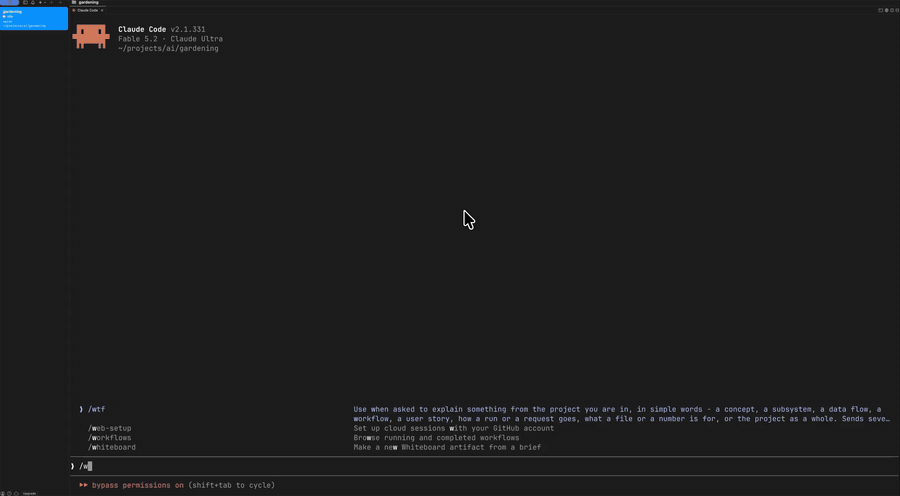

# skills

My personal agent skills. Small, readable, meant to be copied and changed.

## The skills

### `/wtf`

Explains something from the project you are in, in plain words, on a page.

```text
/wtf how does a request get from the api to the worker?
```

[](media/wtf.mp4)

You ask a question about your codebase. Several agents read the code, the notes and the
history in parallel. The answer opens in the browser as one page of diagrams, each with
numbered notes. Ask a follow-up and the same page grows a new section.

## Install

Clone the repo and link the skill you want into your personal skills folder:

```bash
git clone https://github.com/vtemian/skills.git ~/projects/ai/skills
ln -s ~/projects/ai/skills/skills/wtf ~/.claude/skills/wtf
```

`SKILL.md` calls its scripts at `~/.claude/skills/wtf/`, so the link has to be there.
`git pull` updates it.

## License

MIT
