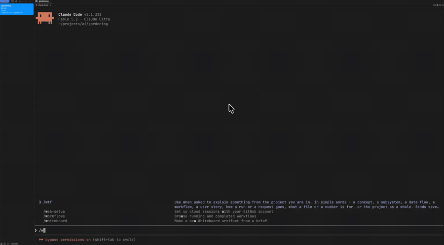

# wtf

Explains something from the project you are in, in plain words, on a page.



```text
/wtf how does a request get from the api to the worker?
```

## What happens

1. Claude takes a quick look at the project and splits your question into parts.
2. Several agents read the code, the notes, the docs and the history in parallel.
3. Claude writes the explanation as markdown with Mermaid diagrams.
4. `scripts/page.sh` builds one HTML page from it. The page carries Mermaid inside it
   and draws its own diagrams when it opens.
5. The page is opened once without you, to check that every diagram draws and the
   layout is right. Then it opens in your browser.
6. A follow-up question adds a section to the same page.

## Install

```bash
curl -fsSL https://raw.githubusercontent.com/vtemian/skills/main/install.sh | bash
```

Pick `wtf` when it asks. It links this folder at `~/.claude/skills/wtf`, where `SKILL.md`
expects its scripts.

## Requirements

Node.js. Nothing else to install: Mermaid and the markdown parser are in `scripts/vendor/`.

The page is checked before you see it, with what the machine already has:

- macOS with `swiftc` (Xcode command line tools): the page is opened in WebKit, the
  diagrams and the layout are checked, and a picture of the page is saved.
- Otherwise, Chrome, Chromium or Brave if one is installed: only that the diagrams draw.
- Neither: the page is built and opened unchecked.

## Files

| File | What it does |
| --- | --- |
| `SKILL.md` | The instructions Claude follows. |
| `scripts/look.sh` | Lists the project's files, docs and last commits. |
| `scripts/page.sh` | Builds the page from the markdown, checks it and opens it. |
| `scripts/render.mjs` | Writes the HTML page: text, diagram text, numbered notes, margin notes. |
| `scripts/cards.mjs` | Prepares a flowchart to be drawn as cards. |
| `scripts/page.js` | Runs in the page: draws the diagrams, places the cards, steps through the notes. |
| `scripts/page.css` | The look of every page. |
| `scripts/mermaid.json` | The diagram colours, the same values as in `page.css`. |
| `scripts/icons.json` | The kinds of box a diagram can have, and their icons. |
| `scripts/snap.swift` | Opens the page in WebKit, checks it and takes a picture. |
| `scripts/drawn.mjs` | The check without WebKit: asks a headless Chrome whether the diagrams drew. |
| `scripts/vendor/` | Mermaid 12.3.0 and marked 4.3.0, with their licenses (both MIT). |

## Run the scripts by hand

```bash
~/.claude/skills/wtf/scripts/page.sh /absolute/path/to/explanation.md
```

It writes `explanation.html` next to the markdown, and `explanation.png` when the WebKit
check runs. Each page is about 5.6 MB, because it carries Mermaid.
