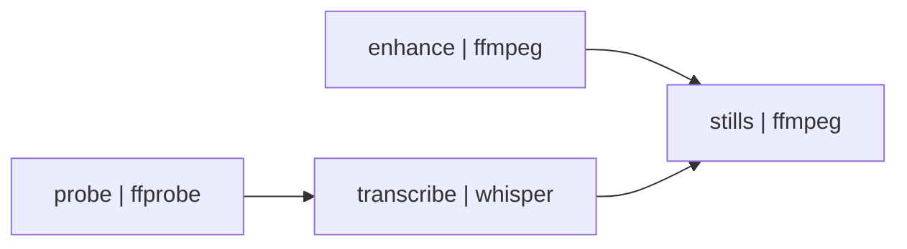

# wtf

The person wants to understand something in this project without reading it all
themselves. Agents do the reading. You do the explaining, in the words one person
uses with another. The explanation is a page in the browser made of diagrams:
each diagram is one idea, and the text is there only to help read it. The chat
gets the short answer and the link.

Two jobs, kept apart on purpose:

- **Scouts** (Opus subagents) collect facts with evidence. They do not write for the person.
- **You** (the main session, Fable) write the explanation. The plain voice has to
  come from one head. An explanation stitched from four reports reads like four reports.

## 1. Pin down the question

Say in one sentence what you will explain. If the ask is vague ("explain the
project"), pick the reading a newcomer needs first - what it is for, what goes in,
what comes out, the main path between - say that you picked it, and go. The person
can redirect. Do not open with questions back to them.

Take a quick look yourself first (file tree, README, notes, recent commits) -
enough to split the question well, not enough to answer it. Start with one
command, which lists the files, the docs and the last commits, and never fails:

```
~/.claude/skills/wtf/look.sh
```

Do not probe for files that may be missing with a bare `ls` or a glob
(`ls CLAUDE.md docs/*.md`): zsh ends the command with "no matches found" and the
whole call shows as failed. Use `look.sh`, or `find . -name '<pattern>'`.

Find the project's own words while you look: the terms its `CLAUDE.md`, README,
notes and code use. The explanation uses those words and no synonyms of them.

## 2. Send the scouts

Split the question into angles that do not overlap, one scout each. Typical splits:

- by stage: where it starts / what happens in the middle / where it ends up
- by layer: what the person sees / the logic / the data at rest
- by source: the code / the notes and docs / git history and past runs
- by actor, for a user story: each person or system and what they do

Size to the question: a narrow one ("what does this function do") gets one scout,
a subsystem gets two or three, the whole project gets four or five. More than five
returns overlap and nothing new.

Spawn them all in one message so they run together: Agent tool,
`subagent_type: general-purpose`, `model: opus`. Give each this brief with the
brackets filled in:

```
I need facts to explain something to a person who has not read this project.
Other scouts are covering other angles in parallel, so stay on yours and go deep.
Read only: do not change, create or run anything that writes.

The question: [the one-sentence question]
Your angle: [the angle, and where to start looking]
Not yours: [the other scouts' angles, one line]

Look wherever the answer lives: code, README and notes, docs, config, scripts,
git log, sample data and outputs. Read whole files when they matter.

Report back, short and concrete:
1. What is here - each thing that matters, its real name, where it lives
   (path:line), and what it does in one plain sentence.
2. What happens, in order - each step: what triggers it, what does the work,
   what goes in, what comes out, what happens next. Name the actual data.
3. One real example, traced end to end with actual values from the repo if you
   can find one (a real input, a real row, a real run).
4. Why it is this way, only where the repo says so (a note, a comment, a commit).
5. Surprises - anything that works differently from what the name suggests.
6. What you could not find or are not sure of. Say so; do not guess.

Mark every claim as seen (with path:line) or inferred.
```

## 3. Check before you explain

Scouts overlap and sometimes disagree. Where two disagree, or where the whole
explanation hangs on one claim, open the file and look. A wrong explanation told
simply is worse than none, because simple words sound sure.

Carry the gaps through. If nobody could find why something is the way it is, the
explanation says "the repo does not say why". A claim a scout only inferred goes
in a `[!WARNING]` margin note, not in the running text as a fact.

## 4. Explain

The diagrams carry the explanation. Text supports a diagram; it never carries an
idea on its own. Plan the page as two to four ideas, each one a diagram, before
you write a word.

The page, top to bottom:

1. **`# Title`, then the answer in one or two sentences.** What the thing is and
   what it is for. Someone who stops here should leave with something true.
2. **One section per idea.** Each section is:
   - a `## ` heading that states the idea as a sentence a reader could repeat:
     "Seven steps, and one stop for a person" - not "Overview" or "The steps";
   - one line on how to read the diagram (what a box is, what an arrow means,
     what the colour marks);
   - the diagram;
   - the notes on its boxes (section 6). This is where the detail goes: the real
     values of the example, the surprise, the "why".
   - nothing more. At most 60 words of text beside a diagram; the page prints a
     `warn` past that, and for a section with no diagram.
3. **`## Where to look`**: three to six `path:line` pointers, then one line
   naming the two or three threads worth pulling.

Put the real example on the diagrams, not in a paragraph: the values of one real
run in the box notes ("`words.json` - 49 timed words for the 19.8 s sample"), or
one diagram that follows that run. Order the ideas the way a newcomer needs them:
the main path first, then what moves along it, then the states or the exceptions.

No section of prose: no "context" section, no "the pieces" list, no "easy to get
wrong" list. Each of those facts belongs to a box - write it as that box's note.
A fact that belongs to no box on any diagram is either a missing diagram or not
needed.

### The words

Write Simplified Technical English (ASD-STE100). The rules that matter here:

- One idea per sentence. At most 20 words when the sentence says what happens,
  25 when it describes.
- Active voice, present tense: "the worker reads the file", not "the file is
  then read".
- One word, one meaning. If the code calls it `run` and the notes call it
  `trial`, pick the project's word, mention the other once, and keep to it. Never
  vary a term to avoid repeating it.
- The project's own words. When you first use one, say what it
  means: "the harness - the script that starts a run and collects what it
  produced". On the page a definition can be a `[!NOTE]` margin note.
- Simple verbs with a clear actor. "The sweep moves the job to `done`", not "job
  finalisation occurs".
- No more than three nouns in a row. "The job status update function" is "the
  function that updates the status of the job".
- Say the mechanism, not a label for it. "It writes one line per step to
  `train.jsonl`, and the chart reads that file" - not "it uses a logging layer".
- No "essentially", "under the hood", "at its core", "in a nutshell", no preview
  of what you are about to say.
- An everyday comparison when one really fits. Say where it stops fitting. Never
  force one.
- Real names and numbers from the repo, never invented ones.
- Smallest complete answer first. Do not cover everything the scouts found; what
  did not make it in is what the person asks about next. End with one line naming
  the two or three threads worth pulling, not a summary.

Always answer in English, whatever language the question came in. Diagram labels
too.

## 5. Draw

Every idea on the page is drawn. If an idea has fewer than three parts, it is a
note on another diagram, not a section.

One diagram answers one question. Two questions are two diagrams. Pick by the
question:

| The question | Draw | A card is | On the arrows |
| --- | --- | --- | --- |
| what happens, in what order | `flowchart TD` | a step: `probe` | nothing, or the condition out of a gate |
| what data goes where | `flowchart TD` | a thing that makes, changes or holds data: `words.json` | the step or the data that moves |
| what a person does and gets | `flowchart TD` starting at the person | the person, the screens and things they meet | what the person does: `uploads video` |
| what states a thing passes through | `flowchart TD` | a state: `paid` | the event that moves it: `owner pays` |
| what it is made of, who depends on whom | `flowchart TD` | a module or a process | the dependency: `imports` |
| who talks to whom, and when | `sequenceDiagram` | - | the message: `start run` |
| what the stored data looks like | `erDiagram` | - | the relation: `has many` |

A flowchart is the page's own drawing: Mermaid places the boxes and arrows, and
the page draws each box as a card with an icon, a title and one line of detail.
The other two types keep Mermaid's plain drawing; use them only when the
question is really theirs.

### A card

```
probe["probe | ffprobe"]:::search
```

- **Title** (before the `|`): one to three words, the project's name for the thing.
- **Detail** (after the `|`, optional): one short fact in the same card - the tool
  that does the work, or the real value from the example run (`49 timed words`,
  `1280×720`). At most about 28 characters.
- **Kind** (`:::kind`): what sort of thing this is. It picks the icon and the
  colour, so the reader sees "a file", "a person", "an AI run" before reading a
  word. Give every card a kind; the page prints a `warn` for one without.

| Kind | Use it for |
| --- | --- |
| `person` `browser` | someone who acts, the page they act on |
| `api` `worker` `queue` `container` `cloud` `timer` | a process, a queue, a sandbox, an outside service, something that runs on a clock |
| `tool` `code` `search` `render` `design` | a command-line tool, a script, a check or probe, a render, a design step |
| `agent` | a model or AI agent doing the work |
| `file` `video` `audio` `image` `text` `database` | data at rest, by what it holds |
| `email` `payment` `shield` | a message sent, money, a security check |
| `gate` `decision` `wait` | waits for a person, a branch, waits for something else |
| `ok` `fail` `start` `state` | a good end, a bad end, a beginning, a plain state |

Pick the kind by what the thing is, and keep it the same on every diagram of the
page: a file is a file card everywhere. Say what a recurring icon means in the
line above the diagram when it carries the idea ("the robot marks a Codex run").

Keep it readable at a glance:

- At most nine cards. More than nine: draw the overview with each group as one
  card, then one diagram per group.
- Top-down (`TD`) by default: it leaves the notes room beside the diagram. `LR`
  only for four cards or fewer. The page prints a `warn` when a diagram is too
  wide.
- A `subgraph name["label"]` draws a dashed frame: use it for a real boundary
  (one process, one container, one machine), not for decoration.
- For a flow with many parts, build it up: the first diagram shows the main path,
  the next redraws it and adds one thing (the error path, the cache, the second
  actor). One diagram with everything at once is a reference, not an explanation.
- Label what the arrow carries. An unlabelled arrow in a data flow says nothing.
- Never draw something a scout did not see. A card with no evidence is a guess
  that looks like a fact.

Mermaid breaks on small things. Write it this way and it will not:

- declare every card once, with a quoted label: `step["read file | once"]:::tool`
- ids are plain lowercase words with no `_` or `-`; never `end`, `class`,
  `graph`, `style` as an id
- no HTML, no emoji, no colours, `classDef`, `style` or `%%{init}%%` - the kind
  sets the look
- in `sequenceDiagram`, declare `participant` lines first, short alias `as` readable name

What the reader can do on the page, so you write for it: pointing at a card or
its note keeps that card, its arrows and its neighbours and fades the rest;
clicking keeps it chosen; the arrows above the notes (or the arrow keys) walk the
noted cards in the order of the notes. So write the notes in the order a person
should meet the cards - usually the order of the flow.

## 6. Annotate

The page understands two things beyond plain markdown. Both still read well as
plain markdown, so the same file works in the chat and on GitHub.

**Notes on a diagram.** Put a list straight after the ` ```mermaid ` block. Each
item starts with the id of a card in backticks, then what is worth knowing about
that card. The page puts the note's number on the card and lists the notes beside
the diagram, each under the card's title.

````


- `enhance` — It has no status of its own, so it runs beside the others.
- `transcribe` — Whisper reads the original upload, never the enhanced file.
````

Note most boxes - the notes are the text of the page. One or two short sentences
each: what the box does that its label cannot say, the real value from the
example, the surprise. A note that repeats the label is noise.
The id is the Mermaid id (`enhance`), not the label; for a sequence diagram it is
the participant's alias. A `warn` line from the page means an id matched no box.

**Margin notes.** A blockquote that starts with a marker becomes a note in the
margin, beside the paragraph or list written just above it:

```
> [!NOTE]
> **Brief**: a fixed text in `agents/` that tells one Codex agent how to do its phase.
```

| Marker | Shown as | Use it for |
| --- | --- | --- |
| `[!NOTE]` | Note | a term defined, a side fact, a "why" the repo states |
| `[!IMPORTANT]` | Easy to get wrong | a name that misleads, a thing that works differently from what one expects |
| `[!WARNING]` | Not verified | a claim a scout inferred, a number from one run, "the repo does not say" |

A margin note is two or three sentences, and sits beside the line above a
diagram. At most one per section. Prefer a box note; use a margin note only for
what belongs to the whole diagram and to no single box.

Everything else is plain markdown: one `# Title`, the answer as the first
paragraph under it (the page sets it large), `## ` sections (the page numbers
them), `path:line` in backticks.

## 7. Build the page, then answer

Write the whole explanation to `<slug>.md` in the session scratch directory and
build the page, with the project as the working directory:

```
~/.claude/skills/wtf/page.sh <absolute path>/<slug>.md
```

It does four things and prints one line for each:

- `ok` / `FAIL` per diagram: parsed with the real Mermaid parser. A `FAIL` carries
  the parser's message.
- `warn`: something the reader will trip on - a diagram too wide, a card with no
  kind, a note that matches no card, a section with too much text or no diagram.
- `page`: `<slug>.html` beside the markdown, one file, nothing loaded from the
  network. It opens in the browser (`NO_OPEN=1` builds without opening).
- `look`: the page drawn in WebKit, checked (every card on its own box, no two
  cards on top of each other, no title cut off), and saved whole as `<slug>.png`.

It exits 0 only when every diagram draws and the layout check passes. Fix every
`FAIL`, every `warn` and every `look` finding and run it again until there is
none. Then Read `<slug>.png` yourself before you say the page is ready: the
checks cannot see a diagram that is correct but hard to read, an arrow that
crosses three others, or a note far from its card. That is yours to fix in the
markdown.

Never tell the person the page is ready on the strength of one browser. The
picture is WebKit; the person may be on Chrome. When they report something you
cannot see in the picture, look in their browser (see Follow-ups).

Then answer in the chat, short: the one or two sentence answer, the full path of
the page, the "where to look" pointers, and the threads worth pulling. Do not
paste the whole explanation again; the page is the explanation.

Never change the look per page: no inline HTML, no styles in the markdown. A
change to the look is a change to `page.css` and `mermaid.json` (the same colours
in both), and it applies to every page.

When the person asks to keep it ("save this", "put it in the docs"), write the
markdown to `docs/explainers/<slug>.md` in the repo - GitHub draws the Mermaid
blocks and the margin notes as is.

## Follow-ups

Once a page exists in the session, every later message about it is a follow-up
for this skill, whether or not it names the skill. Work out which kind it is from
what the person sent, and act without asking them to say it another way.

**"It looks wrong"** - a screenshot of the page, "check the result", "it's
broken", "the boxes are on top of each other", "use Chrome and look". The person
is telling you what their browser shows, and it differs from what you checked.

1. Read their screenshot first. Name what is wrong in one sentence before you
   touch anything: which diagram, which cards, what they should look like.
2. Reproduce it. Run `page.sh` again and Read the new `<slug>.png` (WebKit). If
   that looks right, the fault is in the other engine: open the page in Chrome
   (the Chrome tools, or `chrome --headless --screenshot`) and look there. Do not
   reply "it looks fine to me" from one engine.
3. Decide where the fault lives. The same markdown on a healthy renderer would
   draw correctly -> the fault is in the skill's files (`page.css`, `page.js`,
   `render.mjs`, `cards.mjs`, `snap.swift`), so fix it there, for every future
   page, and never by special-casing this page's markdown. The markdown asks for
   something unreadable (too many cards, long titles, crossing arrows) -> fix the
   markdown.
4. Add the check that would have caught it to `snap.swift` when it is a layout
   fault a script can see, and prove it fails on the broken page.
5. Rebuild, Read the picture, open the page again, and say in two lines what was
   wrong and what you changed. Say which browsers you looked in.

**"I don't get it"** - "wait, what", "that did not land", "huh?". Do not repeat
it louder. Re-pitch that part: redraw the diagram simpler (fewer cards, the main
path only), give the context in the line above it, rewrite its notes in shorter
sentences with every project word defined again, and take a different example.
Ask nothing back; if two readings are possible, pitch the more basic one.

**"Change it"** - "shorter", "less text", "more detail on X", "draw that part",
"other icons", "top-down". It is an edit to the same markdown: change it, run
`page.sh`, check the picture, reopen. "Go deeper on X" is a new section with its
own diagram on the same page; answer from what the scouts already returned when
it covers it, and send new scouts only for the angles that are missing.

**"Do it like this from now on"** - a wish about how every explanation should
look or read (the look, the amount of text, the kind of diagram). That is a
change to this skill, not to one page: change `SKILL.md` and the files beside it,
rebuild the current page with them to show the result, and say the skill changed.
