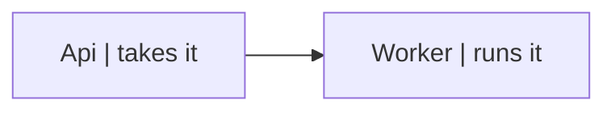

# A page with a diagram that does not draw

One diagram here is wrong on purpose.

## The broken one

```mermaid
flowchart TD
  api["Api | takes it"]:::api --> worker["Worker"]:::worker
  worker --> --> nowhere
```

1. `api` - takes the request

## The good one beside it



1. `api` - takes the request
2. `worker` - runs the job
