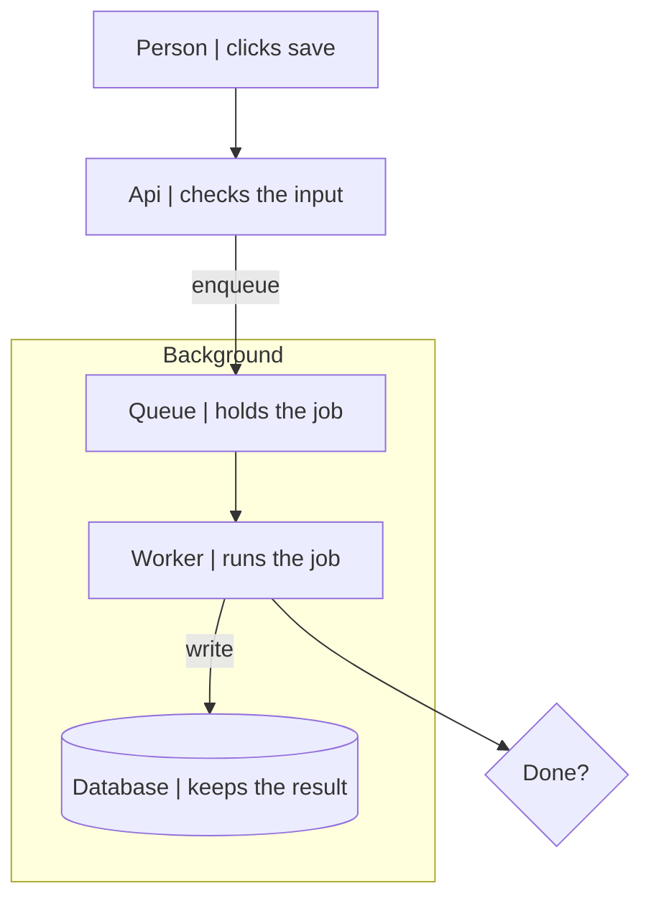
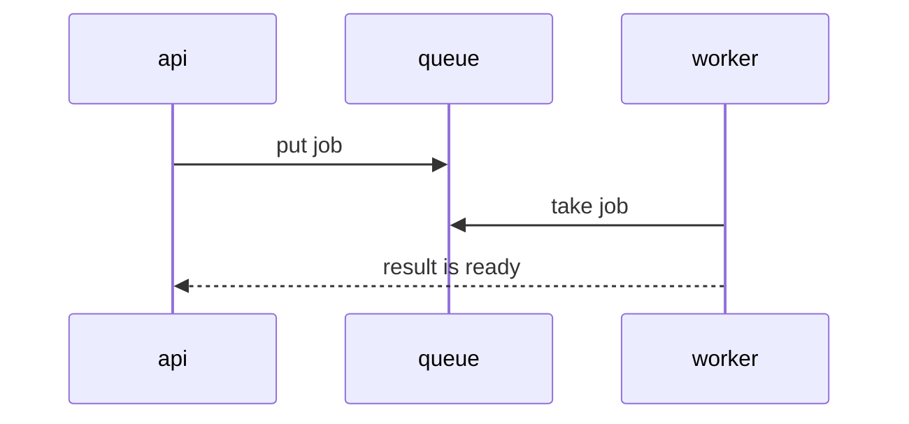

# How a request becomes a job

A request comes in at the api, waits in a queue and is run by a worker. The picture below
shows the path, and the second one shows the order of the calls.

## The path of one request

Read top to bottom. Each card is one process.

1. `user` - the person who starts it
2. `api` - takes the request and answers at once
3. `queue` - the job waits here
4. `worker` - picks the job up and runs it
5. `db` - the result is written here

> [!NOTE]
> The api never waits for the worker.

## The order of the calls

Time runs down.

1. `A` - sends the job and returns
2. `W` - takes it later

> [!WARNING]
> The retry count was read from the code, not seen in a run.

## Where to look

- `app/api.py:12` - the route
- `app/worker.py:40` - the job

| Process | Count |
| --- | --- |
| api | 1 |
| worker | 4 |
