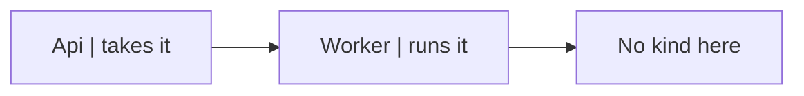

# A page the author should fix

Everything draws, but three things are off.

## One diagram

1. `api` - takes the request
2. `ghost` - is not a box in the diagram

## A section with only words

There is no diagram in this section.
